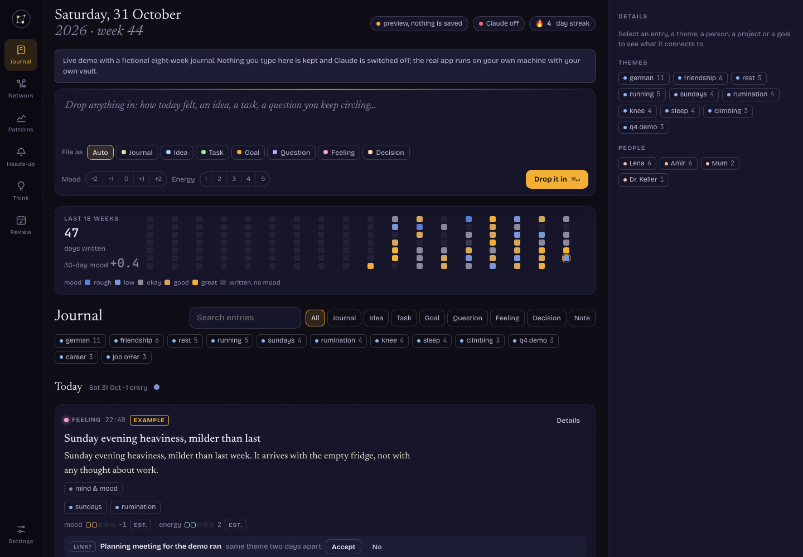
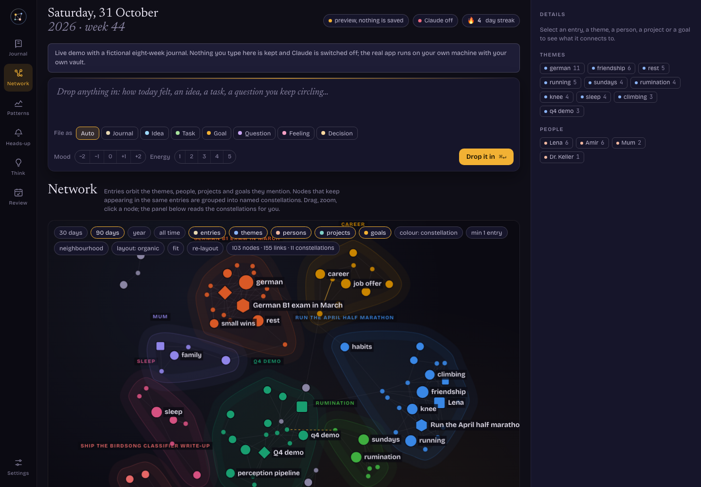
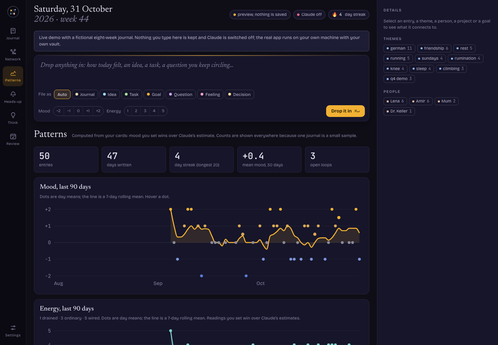
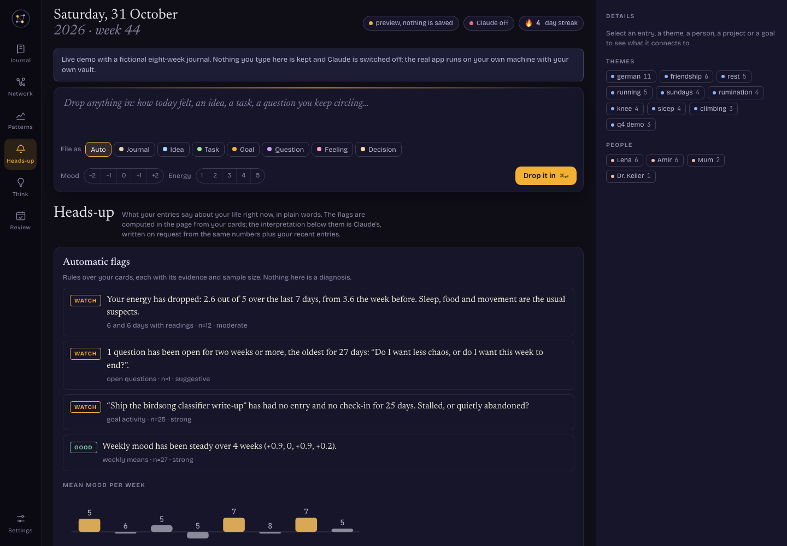
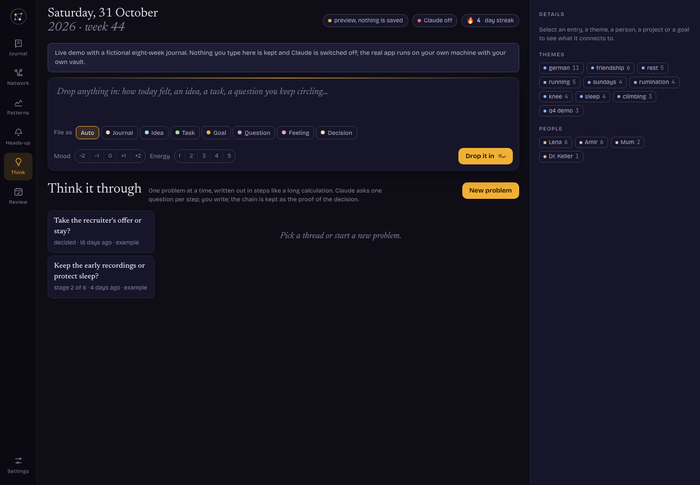
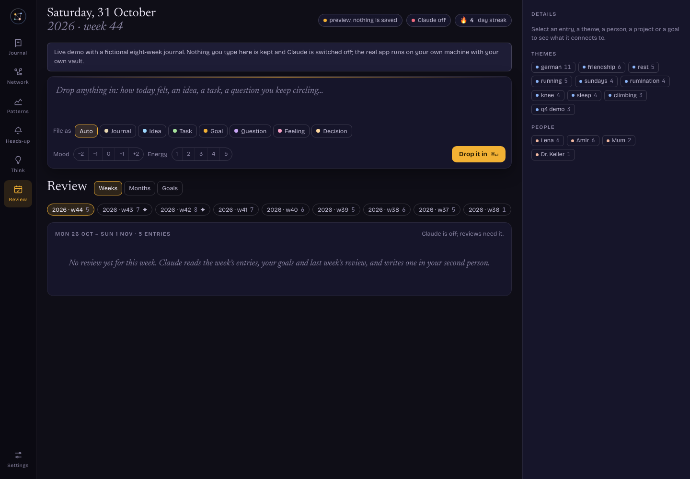
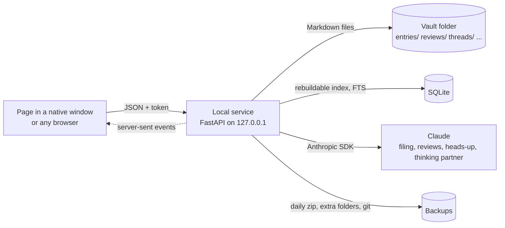

# Second Brain

[](https://github.com/ShayanHemm/second-brain/actions/workflows/tests.yml) [](LICENSE)

A local-first journal that files itself, links what you write into a network, and tells you in plain words what it sees in your own entries. Your data is a folder of Markdown files on your machine. Claude does the reading; you keep the keys.

**[Live demo](https://shayanhemm.github.io/second-brain/)** with a fictional eight-week journal (no account, nothing saved, Claude switched off) · [How it works](#how-it-works) · [Install](#install-macos) · [Design notes](docs/DESIGN-NOTES.md) · [Architecture](docs/ARCHITECTURE.md)



## What it does

**Drop anything in.** One box. A journal entry, a feeling, an idea, a task, a goal, a question. You can set mood and energy by hand or leave it to the model.

**It files the entry into a card.** Claude returns a fixed form, never prose: title, type, summary, mood and energy estimates, two to five concrete themes, one or two life domains, people, projects, goals touched, tasks, open questions, link proposals to earlier entries, and a follow-up question. Every theme and every estimate must be backed by a quote from the entry, and the page checks the quotes against the text before accepting them. Hover a theme to see why it is there. Anything can be edited; your own mood setting always wins over the estimate.

**The network draws the constellations.** Themes, people, projects and goals that keep appearing in the same entries are grouped by community detection and drawn inside named hulls. A theme that runs through most entries is treated as backdrop rather than a group, so it cannot swallow the picture. Filter by time, kind and link strength, isolate a node's neighbourhood, or switch to a timeline layout.



**Patterns are computed, not guessed.** Mood and energy over time, weekday profile, writing rhythm, theme trends month over month, themes against mood, a mood-against-energy quadrant that separates agitation from depletion, open loops. Every statement carries its sample size, because one journal is a small sample. Claude narrates the numbers only when asked.



**Heads-up.** Rules over the cards raise flags with evidence: a mood or energy drop week over week, a run of low days, a writing gap, questions left open, goals without activity, a theme taking over, late-night low entries, a conditional trend projection. Above them, on request, Claude's interpretation: where you are, what is in play, warnings, cautious forecasts, small suggestions, blind spots, one question. Readings are kept per day so you can look back.



**Think it through.** One problem at a time, six stages from *Problem* to *Next step*. Claude asks one question per step, you write, and the chain is stored as the proof of the decision. The decision becomes an entry with its next step as a task.

**Reviews.** Weekly reviews written from the week's entries, the goals and the previous review; monthly reflections written from the weekly ones, so the brain can hold years without re-reading everything. Goals with progress check-ins.

| Think it through | Review |
|---|---|
|  |  |

## How it works



- **Vault** (`~/SecondBrain` by default): every entry is one `.md` file with the card as YAML front matter and your text as the body. Reviews, thinking threads and daily readings are Markdown too; goals and settings are small JSON files. The folder opens in Obsidian or any editor. See [`docs/ARCHITECTURE.md`](docs/ARCHITECTURE.md) for the layout and the schema.
- **Service**: serves the page, reads and writes the vault, keeps an SQLite index with full-text search (rebuildable from the files at any time), pushes live updates to open windows, holds the API key, runs the backups. It binds to the loopback interface only, and every request carries a per-installation token the page receives when it loads.
- **Claude**: `claude-opus-5-5` by default for everything, filing at low effort and reviews at high; Haiku 4.5 is one click away for cheaper filing. Prompts live in the page; the service relays them, enforces JSON when asked, maps errors to the codes the interface understands, and logs every call's tokens and cost.
- **Interface**: one HTML page, vanilla JavaScript, d3-force for the network, SVG for the charts. The same page runs in the native macOS window, in a browser, and as the static demo on GitHub Pages with a baked-in sample journal.

### Filing with evidence

The filing prompt carries a rubric (mood anchors from −2 to +2, energy from 1 to 5, type definitions, theme rules that forbid catch-all labels such as *life*, *problems* or *stress* and demand the concrete subject) and a worked example. The list of themes already in the brain is offered as a spelling vocabulary, explicitly not a menu. The model must quote the words behind each theme and each estimate; the page drops a theme whose quote is not in the text, and if an entry of eight words or more ends up with fewer than two themes, it runs a second pass that names the failure. This design came from a real failure: an early version reused the only existing label for every new entry. [`docs/DESIGN-NOTES.md`](docs/DESIGN-NOTES.md) tells that story.

### Finding constellations

Concept nodes are linked when they appear in the same entry. Edge weights are Jaccard-normalised (shared entries over the union), communities are found by Louvain modularity optimisation with a resolution sweep that stops once no community holds more than 60% of the nodes, and themes present in more than half of the entries are set aside as backdrop and drawn with a gold ring. A custom force gathers each constellation around its own centre and keeps constellations apart; hulls are smooth closed curves; labels avoid each other.

### Data you own

- Deleting a card moves it to a trash you can restore from; "Delete forever" moves the file into the vault's `trash/` folder. The app never unlinks a document.
- A zip snapshot of the vault is written once a day, thirty kept plus the first of each month, copied to any extra folders you name (an iCloud or Drive folder is a good one), optionally committed to git.
- Complete JSON and Markdown exports from the app or the command line; imports are merge-safe and never overwrite a newer card or delete anything.
- The API key lives in `~/.config/second-brain/`, never inside the vault or its backups.

## Install (macOS)

```sh
git clone https://github.com/ShayanHemm/second-brain.git
cd second-brain
./install.sh                 # private Python environment, dependencies, page build
source .venv/bin/activate
sb key set                   # paste an Anthropic API key (console.anthropic.com); skip to run without Claude
sb app                       # open the window; or: sb serve --open for the browser
sb bundle install            # optional: "Second Brain.app" in /Applications
sb autostart install         # optional: start the service at login so backups run on their own
```

Python 3.11 or newer. Linux works for `sb serve` and the browser; the native window and the app bundle are macOS-only.

| Command | Purpose |
|---|---|
| `sb serve [--port N] [--vault PATH] [--open]` | run the service |
| `sb app` | native window (starts the service if needed) |
| `sb backup` / `sb backup-target add PATH` | snapshot now; extra copy folders |
| `sb git init` | version the vault; every backup then commits |
| `sb import FILE` / `sb export` | merge-safe import; complete export |
| `sb reindex` / `sb doctor` | rebuild the index; check the installation |
| `sb key set` / `clear` / `status` | manage the API key |

**Cost.** With Opus 5.5 at $4 per million input tokens and $20 per million output tokens, filing one entry costs a few cents, a weekly review well under half a dollar. The month's spend is shown in Settings and logged per call in the vault.

## Project layout

```
sb/        config · store (vault + index) · backup · ai (Anthropic SDK) · server (FastAPI) · cli · app (window + bundle)
ui/src/    the page: styles, markup, core, prompts, views, network, patterns, heads-up, think/review/settings, local bridge
ui/build.py           assembles the page the service serves
tools/build_demo.py   assembles the static demo in docs/ with demo/second-brain-demo.json baked in
tools/demo_data.py    composes the fictional sample journal
tests/     vault, API and concurrency tests (pytest)
docs/      live demo, screenshots, architecture and design notes
```

## Honest limits

- Pattern statistics on one person's journal are small-sample by nature. The page says *suggestive* until there is enough behind a claim; it never claims causation.
- Claude's estimates are estimates. The quotes make them checkable; they do not make them right.
- Filing an entry sends its text to the Anthropic API, the same as a chat message. Nothing else leaves the machine.
- The journal view loads the newest thousand entries and pages older ones on request.
- The menu-bar name of the native window reads as the Python process rather than the app; a signed shell would fix it.

## Built with

FastAPI, uvicorn, SQLite with FTS5, PyYAML, the Anthropic Python SDK, pywebview, d3-force, and the Newsreader, Bricolage Grotesque and JetBrains Mono typefaces. Written over a few days with Claude Code as a pair programmer, every design decision argued out loud first.

MIT License.
